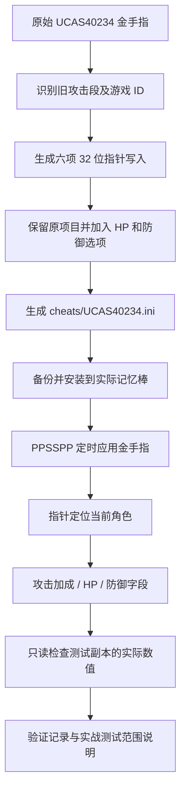

# BLEACH 灵魂嘉年华：金手指修复与验证工具

本仓库保存《死神 灵魂嘉年华》**UCAS40234 / 1.00** 在 **PPSSPP v1.19.3** 上的最新金手指、完整修复代码、地址分析工具和验证材料。默认攻击倍率为 32 倍；增加可选的 99999 HP 和防御力 9999。内容以 2026-10-31 的运行验证为基础，2026-11-10 整理为可迁移的源码项目。

直接使用 `cheats/UCAS40234.ini` 即可；不需要编译应用。仓库没有独立的图形修改器 APP，也不包含 PPSSPP 可执行文件或游戏镜像。`archive/` 保留修复时的原始工作脚本，日常使用入口为 `scripts/`。

## 功能和验证范围

| 项目 | 默认开关 | 当前行为 | 验证情况 |
|---|---|---|---|
| 攻击倍率 32 倍 | 开 | 写入六项攻击属性百分比加成，每项 3100 | PPSSPP 副本中实际读回六项均为 3100 |
| 攻击倍率 16 / 64 倍 | 关 | 分别写入 1500 / 6300；同类只开一项 | 游戏公式及代码结构核对；未分别实战测试 |
| 攻击倍率 1 倍 | 关 | 将六项百分比加成清零 | 会覆盖同字段原有装备、技能加成 |
| 锁 HP 9999 | 开 | 周期性按 32 位写入当前 HP | 保留旧目标值，修正原先 16 位写入宽度 |
| 锁 HP 99999 | 关 | 同时写入当前 HP 和最大 HP | 运行副本中两者均读回 99999 |
| 防御力 9999 | 关 | 提高当前玩家防御，减轻按防御结算的普通物理伤害 | 防御字段读回 9999；未做受击前后对比 |
| 锁 SP 等其他原有项目 | 沿用原文件 | 保留原开关和代码 | 原锁 SP 已读回 999；其他项目不等于全部逐项实测 |

攻击倍率选项只能开启一个；两个锁 HP 选项也只能开启一个。原文件还有角色、经验、地图等默认开启的项目，安装会一并带入这些开关，请在 PPSSPP 的金手指菜单检查。

攻击计算使用 `倍率 = 1 + 加成值 / 100`，此处没有 16 倍上限。后续单次伤害通常封顶 9999，特定类型或状态使用 999999 上限，因此提高倍率未必继续提高最终伤害。锁 HP 是周期补血，不是判定层的无敌；防御选项不保证覆盖灵压、固定伤害和特殊攻击。尚未做打怪、受击前后的完整实战对比。

## 安装运行环境

| 用途 | 需要的环境 |
|---|---|
| 直接使用金手指 | Windows 10/11 x64、PPSSPP v1.19.3 x64、自行准备的 UCAS40234 / 1.00 游戏镜像 |
| 自动安装及测试启动脚本 | PowerShell 7；可以用手工复制替代安装脚本 |
| 重新生成 INI、运行自动检查 | Node.js 20 或更新版本；本次整理使用 Node.js 24，无 npm 第三方依赖 |
| RAM 校验、Windows 运行内存读回 | Python 3.10+ x64；本次使用 Python 3.12，使用标准库 |
| MIPS 反汇编 | Python 与 `requirements-analysis.txt` 中的 Capstone 5.0.9 |
| Git 上传 | Git、对应仓库的读写权限、可连接 GitHub 的网络 |

其他 PPSSPP 或游戏版本没有在本项目中验证。仅使用 INI 时不需要安装 Node.js、Python 或 Capstone。

## 快速使用

1. 正常关闭 PPSSPP。
2. 在模拟器中确认记忆棒目录，将 `cheats/UCAS40234.ini` 复制到该目录的 `PSP/Cheats/` 下，覆盖前备份已有同名文件。
3. 在 PPSSPP 设置中启用“金手指”，启动对应游戏，在暂停菜单的“金手指”中确认开关。
4. 默认使用 32 倍攻击和锁 HP 9999。要用 99999 HP，先关闭锁 HP 9999，再开启锁 HP 99999；防御力 9999 按需勾选。

Windows 常见安装路径是 `<文档>/PPSSPP/PSP/Cheats/UCAS40234.ini`，但便携模式、OneDrive 或自定义记忆棒路径可能不同，以模拟器实际使用目录为准。

PowerShell 7 自动安装：

```powershell
# 在仓库根目录运行；默认目标为系统“文档”文件夹中的 PPSSPP。
pwsh -File scripts/Install-Cheats.ps1

# 自定义记忆棒目录，示例：
pwsh -File scripts/Install-Cheats.ps1 -CheatsDir 'D:\PPSSPP\memstick\PSP\Cheats'

# 只预览安装目标：
pwsh -File scripts/Install-Cheats.ps1 -CheatsDir 'D:\PPSSPP\memstick\PSP\Cheats' -WhatIf
```

安装脚本只安装 INI：已有内容先保存为带时间戳的 `.bak`，安装后比较 SHA-256；目标已经一致时不会覆盖。它不修改游戏存档、不替你切换模拟器的全局开关。

关闭某个金手指会停止后续写入，已写入的属性可能继续保留。需要恢复正常属性时，关闭相关选项、重新启动游戏并从普通游戏存档进入；即时存档会保留当时的修改值。恢复旧 INI 时先关闭模拟器，再用备份覆盖。

## 从源码生成及检查

在仓库根目录运行：

```powershell
node scripts/build-cheats.mjs
node --test tests/build-cheats.test.mjs
python scripts/verify_materials.py
```

生成器从 `materials/UCAS40234.original.ini` 读取原始配置，输出到 `cheats/UCAS40234.ini`。默认输出与已安装、已运行验证的版本逐字节一致。它不会安装到模拟器，也不会启动游戏。

按需生成另一份配置：

```powershell
node scripts/build-cheats.mjs --multiplier 64 --hp 99999 --defense --output work/UCAS40234.ini
pwsh -File scripts/Install-Cheats.ps1 -Source work/UCAS40234.ini -CheatsDir 'D:\PPSSPP\memstick\PSP\Cheats'
```

支持的攻击参数是 `1 / 16 / 32 / 64`，HP 是 `9999 / 99999`。输入须为原始未修复文件；生成器对错误游戏 ID、找不到旧攻击段及不支持的参数会直接报错，避免重复追加。安装前应确认目标 PPSSPP 已关闭。

## 功能流程



## 代码和材料结构

```text
cheats/                  最新可安装 INI
scripts/
  build-cheats.mjs        纯源码生成器及导出的构建函数
  Install-Cheats.ps1      安装备份、哈希确认、重复安装处理
  Start-Test.ps1          启动已准备好的独立 PPSSPP 副本
  read_runtime.py        只读 Windows 进程内存、报告角色属性
  inspect_game.py        MIPS 指令扫描及反汇编
  verify_materials.py    校验参考源码、RAM 和包内文件哈希
  prepare_manifest.py    源码或材料更新后重新生成包清单
  fetch_reference.py     重新获取并核对固定版本的 PPSSPP 参考源码
tests/                   生成一致性、指令结构和开关回归检查
docs/                    地址分析、运行验证与材料索引
materials/
  UCAS40234.original.ini 原始未修复金手指
  ram/                   两份 24 MiB 分析快照和 SHA-256 清单
evidence/                当时的实际读回记录与离线检查结果
reference/               PPSSPP v1.19.3 参考源码、来源和许可证
archive/                 当时的原始工作脚本及报告，含历史本机路径
```

`scripts/` 是现在推荐的入口；`archive/` 用于追溯，不能直接假定历史绝对路径仍存在。`evidence/cheat-analysis.json` 检查的是修复前的 27 项配置，修复后的结论见当前 README 和 [地址分析](docs/analysis.md)。原备用 SP、3 倍速度仍存在指针附加行数问题；本次没有将它们列为已修复功能。

## 复核地址和实际运行值

安装可选反汇编依赖并重现关键代码：

```powershell
python -m pip install -r requirements-analysis.txt
python scripts/inspect_game.py --start 08833D6C --end 08833DF0
python scripts/inspect_game.py --start 08834004 --end 0883408C
python scripts/inspect_game.py --scan
```

运行副本的准备、启动、PID 获取和只读验证见 [预备材料说明](materials/README.md)。示例：

```powershell
pwsh -File scripts/Start-Test.ps1 -Emulator 'D:\PPSSPP-Test\PPSSPPWindows64.exe' -Iso 'D:\Games\BLEACH.iso' -HighHp -HighDefense
# 用上一步输出的实际 PID 替换 1234，进入可操控关卡后读取：
python scripts/read_runtime.py --pid 1234 --expect-multiplier 32 --expect-hp 99999 --expect-defense 9999
```

`read_runtime.py` 仅申请查询及读取进程权限，不写进程内存。新结果输出到被 Git 忽略的 `work/`，不会覆盖历史证据。历史成功记录在 [combined-runtime-validation.json](evidence/combined-runtime-validation.json)：六项攻击加成均为 3100，当前/最大 HP 均为 99999，防御为 9999，SP 为 999。新便携脚本做过源码、语法和材料检查，本次整理没有再次启动游戏做实战测试。

## 上传内容与来源

包含最新代码、原始脚本、INI、分析资料、两份 RAM 快照、验证结果、测试、PPSSPP 源码参考及依赖声明。无需 Git LFS，两个快照各 24 MiB。应用程序、模拟器、游戏 ISO、依赖二进制、临时环境、登录凭据和本机 CA 文件均不在提交中。普通游戏存档和即时存档由本机自行准备，材料文档给出路径及导出方法。

上游参考文件的来源与许可见 [reference/README.md](reference/README.md)。本项目的代码和报告说明的是已检查的版本与范围，不将字段写入验证等同于全部游戏效果验证。

维护者修改代码或材料并完成检查后，运行 `python scripts/prepare_manifest.py` 更新包内哈希，再运行 `python scripts/verify_materials.py`。不要在收到未知文件校验失败时直接重建清单，以免把意外改动当作基线。
