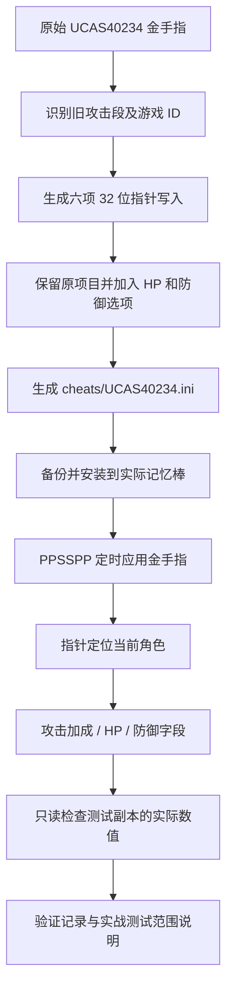

# BLEACH 灵魂嘉年华：金手指修复与验证工具

本仓库保存《死神 灵魂嘉年华》**UCAS40234 / 1.00** 在 **PPSSPP v1.19.3** 上的最新金手指、完整修复代码、地址分析工具和验证材料。默认攻击倍率为 32 倍；增加可选的 99999 HP 和防御力 9999。内容以 2026-10-31 的运行验证为基础，2026-11-10 整理为可迁移的源码项目。

直接使用 `cheats/UCAS40234.ini` 即可；不需要编译应用。仓库没有独立的图形修改器 APP，也不包含 PPSSPP 可执行文件或游戏镜像。`archive/` 保留修复时的原始工作脚本，日常使用入口为 `scripts/`。

## 新电脑首次使用：一步一步安装

**已经有对应模拟器和游戏时，下载本仓库、复制一份 INI、开启金手指即可。手工安装不需要 Git、Node.js、Python 或 PowerShell 7。** 按下面第 1～7 步操作即可；后面的源码与分析工具说明供需要修改代码的人使用。

### 第 1 步：准备模拟器和对应游戏

1. 新电脑使用 Windows 10/11 x64，准备 **PPSSPP v1.19.3 Windows x64**。模拟器可从 [PPSSPP 官方下载页](https://www.ppsspp.org/download/) 或 [官方历史版本](https://github.com/hrydgard/ppsspp/releases) 获取；本项目验证过的是 v1.19.3。
2. 将模拟器压缩包解压到可写文件夹，例如 `D:\Games\PPSSPP`，运行其中的 `PPSSPPWindows64.exe`。
3. 自行准备《死神 灵魂嘉年华》的游戏镜像，要求 **游戏 ID：UCAS40234，版本：1.00**。本仓库没有游戏镜像；其他地区版本、修改版和续作不能直接套用这里的地址。
4. 在 PPSSPP 主界面浏览到游戏镜像所在目录，点击游戏图标，确认能够正常进入游戏，再返回模拟器主界面。这一步用于确认游戏可以运行并初始化记忆棒目录。

如果新电脑还没有模拟器或游戏，需要先完成这一步；仅下载本仓库不能直接启动游戏。

### 第 2 步：下载并解压本仓库

1. 用浏览器打开 [caozichen/BLEACH--Cheat-](https://github.com/caozichen/BLEACH--Cheat-)。
2. 确认页面显示 `main` 分支，点击绿色 **Code** 按钮，再点击 **Download ZIP**。也可以使用 [main 分支 ZIP 下载链接](https://github.com/caozichen/BLEACH--Cheat-/archive/refs/heads/main.zip)。
3. 下载完成后，在 Windows 资源管理器中右键 ZIP，选择 **全部解压缩**，解压到你想保存的目录。
4. 打开解压后的项目文件夹，应该能看到 `README.md`、`cheats`、`scripts`、`materials` 等内容。这里就是后文所说的“项目根目录”。
5. 打开 `cheats` 文件夹，确认里面存在 **`UCAS40234.ini`**。不要在 ZIP 的压缩包预览窗口中直接操作，也不要把整个仓库当作模拟器程序打开。

### 第 3 步：找到 PPSSPP 实际使用的记忆棒目录

1. 打开你要玩游戏的那一份 PPSSPP。
2. Windows 桌面版优先使用顶部菜单 **文件 → 打开记忆棒**。如果界面中没有这一项，在 **设置 → 系统** 中找到“记忆棒文件夹”“查看记忆棒文件夹”一类入口，打开它当前使用的文件夹。
3. 在打开的文件夹中找到 `PSP`，进入后找到 `Cheats`。如果 `Cheats` 不存在，右键空白处，选择 **新建 → 文件夹**，命名为 `Cheats`。
4. 如果模拟器直接打开的已经是 `PSP` 文件夹，就直接进入或创建 `Cheats`，不要再重复创建一层 `PSP`。
5. 保留这个 `Cheats` 文件夹窗口，然后正常关闭 PPSSPP，再进行下一步。

最终文件结构应当是：

```text
实际记忆棒目录/
└─ PSP/
   ├─ Cheats/
   │  └─ UCAS40234.ini       ← 本次要放入的文件
   ├─ SAVEDATA/              ← 普通游戏存档，可能首次保存后才出现
   └─ PPSSPP_STATE/          ← 即时存档，可能首次快速保存后才出现
```

Windows 常见位置为 `<文档>\PPSSPP\PSP\Cheats`，便携模式常见位置为 `<模拟器目录>\memstick\PSP\Cheats`。OneDrive、自定义路径和多份模拟器可能使用其他位置，**以刚才由 PPSSPP 打开的目录为准**，不用照抄旧电脑的盘符或用户名。

### 第 4 步：备份并复制金手指文件

1. 在第 3 步找到的 `Cheats` 文件夹中，查看是否已有 `UCAS40234.ini`。
2. 如果已有同名文件，先把它复制到另外的备份文件夹，或改名为 `UCAS40234.ini.bak`；记录备份位置。没有同名文件时直接继续。
3. 在下载的项目目录中，打开 `cheats`，右键 **`UCAS40234.ini` → 复制**。
4. 回到模拟器实际使用的 `PSP\Cheats`，右键空白处 → **粘贴**。如果仍提示同名覆盖，先确认已经完成第 2 小步的备份，再替换。
5. 确认最终文件名就是 `UCAS40234.ini`。如果看不清扩展名，Windows 11 在 **查看 → 显示 → 文件扩展名** 中打开显示；Windows 10 在“查看”选项卡勾选“文件扩展名”。文件不应变成 `UCAS40234.ini.txt`。

这里复制的是 **INI 文件本身**，不用复制 `scripts` 或 `archive`。`SAVEDATA` 和 `PPSSPP_STATE` 中原有的存档不需要改动。

### 第 5 步：在模拟器中开启并检查金手指

1. 重新打开 PPSSPP，进入 **设置 → 系统**。
2. 找到 **作弊设置 / 开启金手指**，勾选“开启金手指”；英文界面对应 **Enable Cheats**。Windows 顶部菜单如果提供“启用金手指”，也可以从该处开启。
3. 返回主界面，启动对应的《死神 灵魂嘉年华》游戏。
4. 游戏运行时按键盘 **Esc** 打开 PPSSPP 暂停菜单，点击 **金手指**；繁体界面可能显示为“密技”。这里指模拟器的暂停菜单，不是游戏内按 Start 打开的菜单。
5. 确认列表中能看到 **攻击倍率32倍_同类仅开一项**、**锁HP9999_与高HP二选一**、**锁HP99999_与原锁HP二选一**、**防御力9999_降低普通物理伤害** 等项目。默认开启前两项，后两项默认关闭。
6. 原文件还保留了全角色、经验、等级、地图等项目的原开关。开始继续游戏前，一并检查这些项目；不想启用的项目在这里取消勾选。

若列表为空、没有这些名称或压根没有“金手指”按钮，先看下面的“常见问题”，不要把文件改名为别的游戏 ID 来尝试。

### 第 6 步：按需切换攻击、HP 和防御

| 你想使用的效果 | 在金手指列表中的具体操作 |
|---|---|
| 32 倍攻击 | 只勾选“攻击倍率32倍”，其余 1 / 16 / 64 倍项目全部取消 |
| 64 倍攻击 | 先取消“攻击倍率32倍”，再勾选“攻击倍率64倍”；其余倍率也要取消 |
| 16 倍攻击 | 取消其他倍率，再勾选“攻击倍率16倍” |
| 将六项攻击加成清零 | 取消其他倍率，再勾选“攻击倍率1倍”；这也会覆盖同字段的装备、技能加成 |
| 锁 HP 9999 | 勾选“锁HP9999”，取消“锁HP99999” |
| 锁 HP 99999 | **先取消“锁HP9999”，再勾选“锁HP99999”** |
| 提高普通物理防御 | 勾选“防御力9999”；不想使用时取消 |

选择后从暂停菜单继续游戏，进入人物能够走动的关卡再观察效果。更高攻击倍率可能碰到游戏单次伤害上限；反复出现 9999 伤害不一定表示倍率没有生效。防御选项不等于所有伤害免疫。

“锁SP”是此前核实过的 SP 选项；原列表里另一个名为“SP”的备用代码和“3倍移动速度”存在已知行数问题，不在本次修复完成的功能内。

### 第 7 步：关闭效果或恢复原配置

1. 只想停止某项效果：按 **Esc → 金手指**，取消对应项目。想全部停用时，回到模拟器“设置 → 系统”关闭“开启金手指”。
2. 已写入的属性不一定立即恢复。取消选项后正常退出游戏、重启模拟器，再从普通游戏存档进入；读取修改时保存的即时存档会带回当时的内存值。
3. 想恢复原金手指文件：关闭 PPSSPP，将第 4 步备份的旧文件复制回 `PSP\Cheats`，恢复文件名为 `UCAS40234.ini`，然后重启模拟器。
4. 如果普通游戏存档本身已经保存了角色解锁、等级等进度，恢复 INI 不会撤销这部分进度，需要恢复你自己保存的未修改游戏存档备份。

### 常见问题：按顺序排查

| 现象 | 怎么处理 |
|---|---|
| 暂停菜单没有“金手指” | 先在“设置 → 系统”开启金手指，再运行游戏；按 Esc 进入的是 PPSSPP 暂停菜单 |
| 有菜单但列表是空的 | 检查是否放到了**当前这份 PPSSPP**实际使用的 `PSP\Cheats`；关闭模拟器后核对文件名，再重新启动 |
| 列表还是旧的，找不到32倍或高HP | 核对复制来源是本仓库 `cheats/UCAS40234.ini`；备份后覆盖旧文件，并重启模拟器 |
| 文件是 `UCAS40234.ini.txt` | 打开文件扩展名显示，去掉末尾 `.txt`，保留 `.ini` |
| 别的金手指文件名/游戏ID与UCAS40234不同 | 确认游戏版本；不同地区版本不能靠重命名套用地址 |
| 勾选64倍后攻击数字不再增加 | 游戏通常存在单次9999伤害上限；倍率计算和最终伤害封顶是两个环节 |
| 高HP与9999HP互相覆盖 | 两个锁HP只能开一个；使用99999时关闭9999 |
| 取消选项后属性仍然保持修改值 | 重启游戏，从普通存档进入；不要用修改时的即时存档判断是否恢复 |
| 双击脚本没有反应，或者终端找不到 `pwsh` | 直接按本节手工复制 INI；自动安装脚本是可选方案，不需要为了使用金手指安装开发工具 |

### 已完成的下载与迁移验证

2026-11-10 已从 GitHub 独立下载提交 `af78e65` 的 ZIP，在含中文及空格的新目录中验证：47 个清单文件哈希一致，5 项回归检查通过；全新目录安装、重复安装、旧文件备份和恢复均通过。正式工具不依赖旧电脑的用户名或 F 盘路径。

这是在当前电脑上进行的隔离迁移验证，未在另一台物理电脑重新做实战测试。游戏内数值写入仍以此前 PPSSPP v1.19.3 / UCAS40234 1.00 的运行记录为依据。完整结果见 [新电脑使用验证](docs/new-computer-validation.md)。

## 功能和验证范围

| 项目 | 默认开关 | 当前行为 | 验证情况 |
|---|---|---|---|
| 攻击倍率 32 倍 | 开 | 写入六项攻击属性百分比加成，每项 3100 | PPSSPP 副本中实际读回六项均为 3100 |
| 攻击倍率 16 / 64 倍 | 关 | 分别写入 1500 / 6300；同类只开一项 | 游戏公式及代码结构核对；未分别实战测试 |
| 攻击倍率 1 倍 | 关 | 将六项百分比加成清零 | 会覆盖同字段原有装备、技能加成 |
| 锁 HP 9999 | 开 | 周期性按 32 位写入当前 HP | 保留旧目标值，修正原先 16 位写入宽度 |
| 锁 HP 99999 | 关 | 同时写入当前 HP 和最大 HP | 运行副本中两者均读回 99999 |
| 防御力 9999 | 关 | 提高当前玩家防御，减轻按防御结算的普通物理伤害 | 防御字段读回 9999；未做受击前后对比 |
| 锁 SP 等其他原有项目 | 沿用原文件 | 保留原开关和代码 | 原锁 SP 已读回 999；其他项目不等于全部逐项实测 |

攻击倍率选项只能开启一个；两个锁 HP 选项也只能开启一个。原文件还有角色、经验、地图等默认开启的项目，安装会一并带入这些开关，请在 PPSSPP 的金手指菜单检查。

攻击计算使用 `倍率 = 1 + 加成值 / 100`，此处没有 16 倍上限。后续单次伤害通常封顶 9999，特定类型或状态使用 999999 上限，因此提高倍率未必继续提高最终伤害。锁 HP 是周期补血，不是判定层的无敌；防御选项不保证覆盖灵压、固定伤害和特殊攻击。尚未做打怪、受击前后的完整实战对比。

## 安装运行环境

| 用途 | 需要的环境 |
|---|---|
| 直接使用金手指 | Windows 10/11 x64、PPSSPP v1.19.3 x64、自行准备的 UCAS40234 / 1.00 游戏镜像 |
| 自动安装及测试启动脚本 | PowerShell 7；可以用手工复制替代安装脚本 |
| 重新生成 INI、运行自动检查 | Node.js 20 或更新版本；本次整理使用 Node.js 24，无 npm 第三方依赖 |
| RAM 校验、Windows 运行内存读回 | Python 3.10+ x64；本次使用 Python 3.12，使用标准库 |
| MIPS 反汇编 | Python 与 `requirements-analysis.txt` 中的 Capstone 5.0.9 |
| Git 上传 | Git、对应仓库的读写权限、可连接 GitHub 的网络 |

其他 PPSSPP 或游戏版本没有在本项目中验证。仅使用 INI 时不需要安装 Node.js、Python 或 Capstone。

## 可选：用 PowerShell 7 自动安装

上面的手工安装已经能够使用完整金手指。如果电脑已安装 PowerShell 7，也可以让安装脚本自动备份和复制 INI。

1. 先按前面的第 3 步查清实际记忆棒目录，并正常关闭 PPSSPP。
2. 打开解压后的项目根目录，也就是同时包含 `README.md` 和 `scripts` 的文件夹。
3. 在资源管理器的地址栏输入 `pwsh` 后按 Enter，从当前目录打开 PowerShell 7。执行 `pwsh --version` 应显示版本 7.x；若提示找不到 `pwsh`，使用前面的手工复制方法即可。
4. 在新终端中执行下面一条合适的命令。自定义目录示例要替换为你的实际 `PSP\Cheats` 路径。

```powershell
# 在仓库根目录运行；默认目标为系统“文档”文件夹中的 PPSSPP。
pwsh -File scripts/Install-Cheats.ps1

# 自定义记忆棒目录，示例：
pwsh -File scripts/Install-Cheats.ps1 -CheatsDir 'D:\PPSSPP\memstick\PSP\Cheats'

# 只预览安装目标：
pwsh -File scripts/Install-Cheats.ps1 -CheatsDir 'D:\PPSSPP\memstick\PSP\Cheats' -WhatIf
```

5. 看到输出中的 `Status` 为 `Installed`，表示已经复制完成；`AlreadyInstalled` 表示目标文件已经与仓库一致。`Backup` 是旧文件备份位置，`Target` 是实际安装路径。运行 `-WhatIf` 仅预览，不会安装。
6. 按前面的第 5～6 步打开 PPSSPP，启用并选择金手指。安装脚本不会替你开启模拟器的全局开关。

安装脚本只安装 INI：已有内容先保存为带时间戳的 `.bak`，安装后比较 SHA-256；目标已经一致时不会覆盖。它不修改游戏存档。如果系统阻止执行下载的脚本，可直接使用本页靠前的手工复制方法，无需为了安装 INI 修改系统执行策略。

## 从源码生成及检查

在仓库根目录运行：

```powershell
node scripts/build-cheats.mjs
node --test tests/build-cheats.test.mjs
python scripts/verify_materials.py
```

生成器从 `materials/UCAS40234.original.ini` 读取原始配置，输出到 `cheats/UCAS40234.ini`。默认输出与已安装、已运行验证的版本逐字节一致。它不会安装到模拟器，也不会启动游戏。

按需生成另一份配置：

```powershell
node scripts/build-cheats.mjs --multiplier 64 --hp 99999 --defense --output work/UCAS40234.ini
pwsh -File scripts/Install-Cheats.ps1 -Source work/UCAS40234.ini -CheatsDir 'D:\PPSSPP\memstick\PSP\Cheats'
```

支持的攻击参数是 `1 / 16 / 32 / 64`，HP 是 `9999 / 99999`。输入须为原始未修复文件；生成器对错误游戏 ID、找不到旧攻击段及不支持的参数会直接报错，避免重复追加。安装前应确认目标 PPSSPP 已关闭。

## 功能流程



## 代码和材料结构

```text
cheats/                  最新可安装 INI
scripts/
  build-cheats.mjs        纯源码生成器及导出的构建函数
  Install-Cheats.ps1      安装备份、哈希确认、重复安装处理
  Start-Test.ps1          启动已准备好的独立 PPSSPP 副本
  read_runtime.py        只读 Windows 进程内存、报告角色属性
  inspect_game.py        MIPS 指令扫描及反汇编
  verify_materials.py    校验参考源码、RAM 和包内文件哈希
  prepare_manifest.py    源码或材料更新后重新生成包清单
  fetch_reference.py     重新获取并核对固定版本的 PPSSPP 参考源码
tests/                   生成一致性、指令结构和开关回归检查
docs/                    地址分析、运行验证与材料索引
materials/
  UCAS40234.original.ini 原始未修复金手指
  ram/                   两份 24 MiB 分析快照和 SHA-256 清单
evidence/                当时的实际读回记录与离线检查结果
reference/               PPSSPP v1.19.3 参考源码、来源和许可证
archive/                 当时的原始工作脚本及报告，含历史本机路径
```

`scripts/` 是现在推荐的入口；`archive/` 用于追溯，不能直接假定历史绝对路径仍存在。`evidence/cheat-analysis.json` 检查的是修复前的 27 项配置，修复后的结论见当前 README 和 [地址分析](docs/analysis.md)。原备用 SP、3 倍速度仍存在指针附加行数问题；本次没有将它们列为已修复功能。

## 复核地址和实际运行值

安装可选反汇编依赖并重现关键代码：

```powershell
python -m pip install -r requirements-analysis.txt
python scripts/inspect_game.py --start 08833D6C --end 08833DF0
python scripts/inspect_game.py --start 08834004 --end 0883408C
python scripts/inspect_game.py --scan
```

运行副本的准备、启动、PID 获取和只读验证见 [预备材料说明](materials/README.md)。示例：

```powershell
pwsh -File scripts/Start-Test.ps1 -Emulator 'D:\PPSSPP-Test\PPSSPPWindows64.exe' -Iso 'D:\Games\BLEACH.iso' -HighHp -HighDefense
# 用上一步输出的实际 PID 替换 1234，进入可操控关卡后读取：
python scripts/read_runtime.py --pid 1234 --expect-multiplier 32 --expect-hp 99999 --expect-defense 9999
```

`read_runtime.py` 仅申请查询及读取进程权限，不写进程内存。新结果输出到被 Git 忽略的 `work/`，不会覆盖历史证据。历史成功记录在 [combined-runtime-validation.json](evidence/combined-runtime-validation.json)：六项攻击加成均为 3100，当前/最大 HP 均为 99999，防御为 9999，SP 为 999。新便携脚本做过源码、语法和材料检查，本次整理没有再次启动游戏做实战测试。

## 上传内容与来源

包含最新代码、原始脚本、INI、分析资料、两份 RAM 快照、验证结果、测试、PPSSPP 源码参考及依赖声明。无需 Git LFS，两个快照各 24 MiB。应用程序、模拟器、游戏 ISO、依赖二进制、临时环境、登录凭据和本机 CA 文件均不在提交中。普通游戏存档和即时存档由本机自行准备，材料文档给出路径及导出方法。

上游参考文件的来源与许可见 [reference/README.md](reference/README.md)。本项目的代码和报告说明的是已检查的版本与范围，不将字段写入验证等同于全部游戏效果验证。

维护者修改代码或材料并完成检查后，运行 `python scripts/prepare_manifest.py` 更新包内哈希，再运行 `python scripts/verify_materials.py`。不要在收到未知文件校验失败时直接重建清单，以免把意外改动当作基线。
